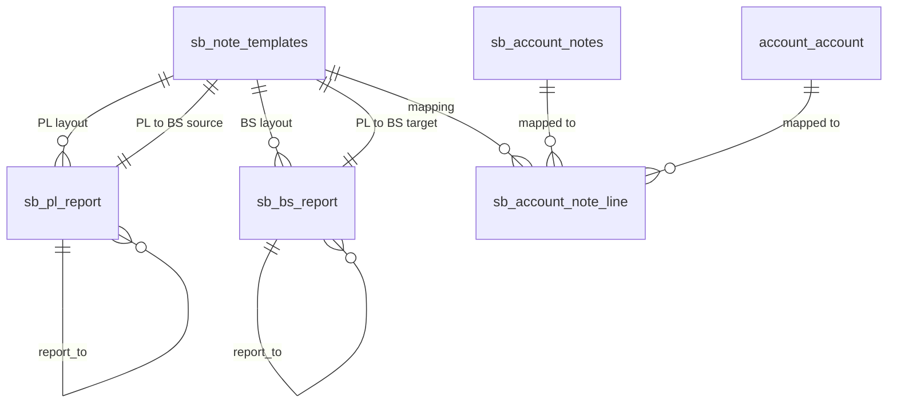

# Accounting Report

Configurable financial reporting for Odoo Accounting. Builds a trial balance,
profit and loss, balance sheet and notes-to-accounts structure from user-defined
note templates, then exports the whole set to a single Excel workbook.

| | |
|---|---|
| **Technical name** | `sb_accounting_reports` |
| **Version** | 18.0.1.0.0 |
| **Odoo series** | 18.0 |
| **Category** | Accounting / Accounting |
| **License** | LGPL-3 |
| **Depends on** | `base`, `account` |
| **External dependency** | `xlsxwriter` (Python) |

---

## Why this module exists

Odoo's standard reports are fixed layouts. Most audit and management-reporting
requirements do not match them: the chart of accounts has to be regrouped into
numbered notes, headers, subtotals and totals, and the result has to be
delivered as a spreadsheet that the finance team can annotate.

This module makes the report structure data instead of code. Notes are records,
their parent/child relationships are user-defined, and a *Note Template*
defines which note appears where in the Profit and Loss and in the Balance
Sheet. The same template then drives the Excel export.

---

## Features

- **Note catalogue** — reusable notes with a manual note number and a type
  (`header`, `detail`, `total`).
- **Note templates** — an ordered Profit and Loss layout and Balance Sheet
  layout per template, with `Report To` to build arbitrary sub-total
  hierarchies and drag-and-drop `sequence` ordering.
- **Account mapping** — accounts are linked to notes from the standard account
  form (*Related Notes* tab) or from the template's lines. A uniqueness
  constraint ensures an account can be mapped only once per template.
- **PL → BS link** — a designated Profit and Loss note can be forwarded into a
  designated Balance Sheet note (the usual "result for the period" line), so
  the balance sheet balances without manual entry.
- **Single-workbook Excel export** containing four worksheets:
  - Trial Balance — previous YTD, movement and current YTD debit/credit per
    account, with its note reference.
  - Profit and Loss — YTD, previous YTD, previous month and current month, with
    headers/totals in bold.
  - Balance Sheet — same period columns, including the forwarded PL result.
  - Notes to Accounts — each detail note with its accounts and balances plus a
    per-note total.
- **Report wizard** in *Accounting → Reporting* with end-date and
  *all accounts / only accounts with movements* options.

---

## Installation

```bash
# 1. Install the Python dependency
pip install xlsxwriter

# 2. Add the module to your addons path, then install
odoo-bin -d your_db -i sb_accounting_reports
```

On a standard Odoo 18 install, `xlsxwriter` is usually already present (it is
used by `account` for its own exports). It is declared in
`external_dependencies` so a missing library stops the install with a clear
message instead of failing during the export.

---

## Configuration

1. Go to **Accounting → Configuration → Account Notes** and create the notes
   you need. Give each one a number (`note_id`), a name and a type.
   - `header` — a section title, contributes no amount.
   - `detail` — a leaf line, receives the balances of its mapped accounts.
   - `total` — an aggregate of its children.
2. Open **Note Templates** and add the note to *Profit and Loss* or
   *Balance Sheet*, setting `Report To` for the parent line. Use the drag
   handle to order the lines.
3. On the *PL to BS* tab, pick the Profit and Loss note whose result should be
   carried into the Balance Sheet, and the Balance Sheet note that receives it.
4. On each account, open the *Related Notes* tab and add the template/note
   pairs it belongs to.

---

## Usage

**Accounting → Reporting → Trial Balance Report**

| Field | Description |
|---|---|
| Display Accounts | `All` includes accounts with no movements, `With movements` hides them |
| End Date | Period end; the previous month and previous YTD cut-offs are derived from it |
| Note Template | The structure to export |

Click **Export** and the workbook is downloaded.

---

## Technical notes

- The report columns are built with four `account.move.line` grouped reads
  (previous YTD, current YTD, previous month, current month) that are merged
  into one account data structure, so the number of SQL queries stays constant
  regardless of the number of accounts.
- Note hierarchies are built as dictionaries and resolved recursively
  (`_build_pl_note_hierarchy`, `_build_bs_note_hierarchy`,
  `_calculate_note_amounts`), which keeps the ordering and the aggregation
  logic independent of the accounts.
- The Excel file is generated in memory with `xlsxwriter` and streamed by a
  controller (`/xlsx_reports`). The front end registers an `xlsx` handler in
  the `ir.actions.report handlers` registry, so the wizard can return a plain
  `ir.actions.report` action and the standard download utilities handle the
  response.
- Debit and credit are netted per period before being written, so each period
  shows a single signed column pair.

### Known limitations

- Only **posted** journal items are considered.
- The module is **single-company**: no `company_id` on the note models and no
  company record rules yet.
- The hierarchy is recalculated per line on export; for very deep trees this
  could be memoised.

---

## Module structure

```
sb_accounting_reports/
├── __manifest__.py
├── controllers/
│   └── main.py                 # /xlsx_reports download route
├── models/
│   ├── account.py              # account.account extension + note mapping lines
│   ├── notes.py                # account notes and note templates
│   └── reports.py              # PL / BS report line definitions
├── reports/
│   └── sb_excel_report.py      # data aggregation and worksheet writers
├── wizard/
│   ├── download_report_wizard.py
│   └── download_report_wizard.xml
├── security/
│   └── ir.model.access.csv
├── static/src/
│   └── action_manager.js       # xlsx report handler
└── views/
    ├── account_inherit.xml
    ├── menu.xml
    ├── sb_account_notes.xml
    └── sb_note_template.xml
```

### Data model



---

## Author

Sarah Unokerieghan
